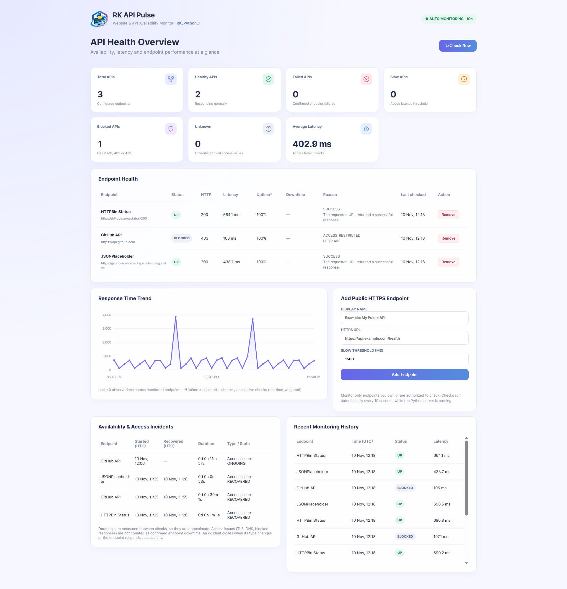

## Application Preview



# RK_Python_1 — RK API Pulse

**RK API Pulse** is a Python-based website and API availability monitoring system that tracks endpoint health, response latency, HTTP errors, and availability incidents. Built with **FastAPI**, **HTTPX**, **SQLite**, and an HTML/CSS/JavaScript dashboard, it provides automated monitoring, diagnostics, and historical performance insights.

## Key Features

- **Automated monitoring:** Checks configured endpoints every 10 seconds, with a manual **Check Now** option.
- **Health classification:** Identifies **UP**, **SLOW**, **DOWN**, **BLOCKED**, and **UNKNOWN** results.
- **Request diagnostics:** Records response latency, HTTP status codes, and error details.
- **Incident tracking:** Records start time, recovery time, and approximate duration, distinguishing outages (**DOWN**) from access issues (**ACCESS_ISSUE**).
- **Endpoint management:** Add or remove public HTTPS endpoints from the dashboard.
- **Performance visualization:** Displays a response-time trend chart without an external charting library.
- **Historical visibility:** Stores monitoring results and incidents in SQLite.

## Technology Stack

| Layer              | Technology              |
| ------------------ | ----------------------- |
| Backend            | Python, FastAPI         |
| HTTP monitoring    | HTTPX                   |
| Database           | SQLite                  |
| Frontend           | HTML5, CSS3, JavaScript |
| API documentation  | OpenAPI / Swagger UI    |
| Testing            | Pytest                  |
| Application server | Uvicorn                 |

## Project Structure

```text
RK_Python_1/
├── app/
│   ├── __init__.py
│   ├── config.py        # Database path, intervals, timeouts, sample endpoints
│   ├── database.py      # SQLite storage and incident tracking
│   ├── checker.py       # URL validation, classification, diagnostics, check loop
│   ├── main.py          # FastAPI routes and application setup
│   └── static/          # Dashboard HTML, CSS, JavaScript, logo and favicon
├── tests/               # Pytest test suite
├── Screenshot.png       # Dashboard preview
├── requirements.txt
├── .gitignore
└── README.md
```

## Installation and Setup (Windows PowerShell)

Open PowerShell in the `RK_Python_1` directory.

**1. Create a virtual environment**

```powershell
python -m venv .venv
```

**2. Activate the virtual environment**

```powershell
.\.venv\Scripts\Activate.ps1
```

If PowerShell blocks activation, run the following command for the current session and then retry activation:

```powershell
Set-ExecutionPolicy -Scope Process -ExecutionPolicy Bypass
```

**3. Install dependencies**

```powershell
python -m pip install -r requirements.txt
```

**4. Start the application**

```powershell
python -m uvicorn app.main:app --port 8002
```

Open the dashboard at **http://127.0.0.1:8002**. Interactive API documentation is available at **http://127.0.0.1:8002/docs**.

Use **one Uvicorn worker** only; running multiple workers can duplicate background monitoring checks.

## Run the Tests

```powershell
python -m pytest -q
```

## Configuration

| Environment variable       | Default                       | Purpose                                                           |
| -------------------------- | ----------------------------- | ----------------------------------------------------------------- |
| `PULSE_DB`               | `pulse.db` next to `app/` | SQLite database file location                                     |
| `PULSE_INTERVAL_SECONDS` | `10`                        | Seconds between monitoring rounds (minimum 10)                    |
| `PULSE_KEEP_DAYS`        | `14`                        | Retention period for check history; incident records are retained |

## API Endpoints

| Method     | Endpoint                     | Description                            |
| ---------- | ---------------------------- | -------------------------------------- |
| `GET`    | `/api/summary`             | Current status of configured endpoints |
| `GET`    | `/api/history?limit=100`   | Recent monitoring checks               |
| `GET`    | `/api/incidents?limit=100` | Availability and access incidents      |
| `POST`   | `/api/endpoints`           | Add a monitored endpoint               |
| `DELETE` | `/api/endpoints/{id}`      | Remove an endpoint and its records     |
| `POST`   | `/api/check-now`           | Trigger an immediate check             |

Example request body for `POST /api/endpoints`:

```json
{
  "name": "Example",
  "url": "https://example.com",
  "slow_ms": 1500
}
```

## Status Classification

| HTTP result or diagnostic                         | Status            |
| ------------------------------------------------- | ----------------- |
| HTTP 200–299, response faster than the threshold | **UP**      |
| HTTP 200–299, response slower than the threshold | **SLOW**    |
| HTTP 401, 403, 407, or 429                        | **BLOCKED** |
| HTTP 5xx, 404, 410, or connection failure         | **DOWN**    |
| Redirects, other 4xx responses, TLS/DNS problems  | **UNKNOWN** |

Monitoring results describe what the **computer running the application** can reach; they do not prove that a service is unavailable to everyone. Incident durations are approximated from check timestamps.

**Uptime percentage** = successful checks ÷ conclusive checks. This is a check-based measure, not a time-weighted availability metric.

## Security and Limitations

- Only public HTTPS endpoints on port 443 are accepted. Localhost, private IP addresses, and `.local` / `.internal` domains are rejected; redirects are not followed.
- Addresses are checked before requests, but a DNS change between validation and connection remains possible. Run this application in a trusted local environment; do not expose endpoint-management APIs to untrusted users.
- Monitor only services you own or are authorized to check. Public sample endpoints are third-party services and should not be polled aggressively.
- Results depend on the local network, DNS, TLS configuration, and internet connectivity.
- SQLite monitoring data and local environment files should not be committed to a public repository.blic third-party services, so don't poll them aggressively.
- Needs internet access; results depend on your network.
