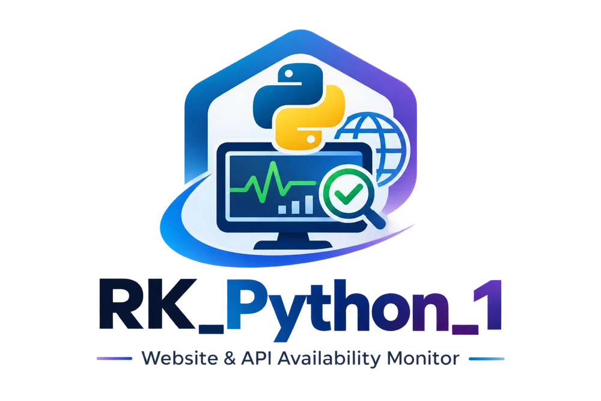

# RK_Python_1 — RK API Pulse

A small Python app that watches public web APIs and shows whether they are up, slow, down or blocking requests. Built with **FastAPI**, **HTTPX**, **SQLite** and a plain HTML/CSS/JavaScript dashboard.

## What it does
- Checks every endpoint automatically every 10 seconds (and on demand with **Check Now**)
- Labels each result **UP**, **SLOW**, **DOWN**, **BLOCKED** or **UNKNOWN**
- Saves latency, HTTP code and error text for every check
- Records incidents (start, recovery, duration) and separates real outages (**DOWN**) from access problems (**ACCESS_ISSUE**: 401/403/429, TLS, DNS)
- Add or remove endpoints from the dashboard
- Draws a response-time chart with no chart library

## Project layout
```
app/
  config.py      settings (database path, interval, timeout, sample endpoints)
  database.py    SQLite tables, saving checks, incident logic
  checker.py     URL safety check, classify(), diagnose(), the checking loop
  main.py        FastAPI routes
  static/        index.html, style.css, app.js, logos
tests/           pytest tests
```

## Run it (Windows PowerShell)
```powershell
python -m venv .venv
Set-ExecutionPolicy -Scope Process -ExecutionPolicy Bypass
.\.venv\Scripts\Activate.ps1
python -m pip install -r requirements.txt
python -m uvicorn app.main:app --port 8002
```
Open http://127.0.0.1:8002 — API docs at http://127.0.0.1:8002/docs. Use **one** Uvicorn worker only (no `--workers`), otherwise checks run twice.

## Run the tests
```powershell
python -m pytest -q
```

## Settings (environment variables)
| Name | Default | Meaning |
|---|---|---|
| `PULSE_DB` | `pulse.db` next to `app/` | SQLite file location |
| `PULSE_INTERVAL_SECONDS` | `10` | Seconds between check rounds (minimum 10) |
| `PULSE_KEEP_DAYS` | `14` | Check history older than this is deleted (incidents are kept) |

## API routes
- `GET /api/summary` — current status of every endpoint
- `GET /api/history?limit=100` — recent checks
- `GET /api/incidents?limit=100` — incidents
- `POST /api/endpoints` — `{"name":"Example","url":"https://example.com","slow_ms":1500}`
- `DELETE /api/endpoints/{id}` — remove an endpoint and all its records
- `POST /api/check-now`

## How statuses are decided
| HTTP result | Status |
|---|---|
| 200–299 and faster than the threshold | UP |
| 200–299 but slower than the threshold | SLOW |
| 401, 403, 407, 429 | BLOCKED |
| 5xx, 404, 410, or connection failure | DOWN |
| redirects, other 4xx, TLS/DNS problems | UNKNOWN |

A result only tells you what the **computer running the app** can reach — it is not proof that a site is down for everyone. Durations are measured between checks, so they are approximate. Uptime % = successful checks ÷ conclusive checks (not time-weighted).

## Safety and limits
- Only public HTTPS URLs on port 443 are accepted; localhost, private IPs and `.local` / `.internal` names are rejected; redirects are not followed.
- The address is re-checked before every request, but a DNS change between the check and the request is still possible. Keep this app on your own computer and do not expose the add-endpoint API to strangers.
- Only monitor services you own or are allowed to check. The three sample endpoints are public third-party services, so don't poll them aggressively.
- Needs internet access; results depend on your network.
