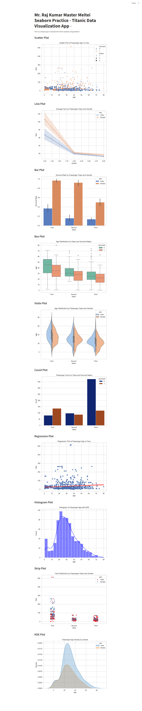
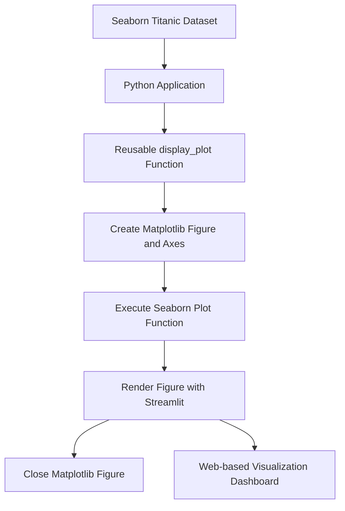

# 🚢 RK_Python_2 | Titanic Data Visualization & EDA


## 📌 Project Overview

A Python-based Exploratory Data Analysis (EDA) and statistical data visualization application developed using Streamlit, Seaborn and Matplotlib. The application explores passenger demographics, survival patterns, ticket fares and relationships between passenger attributes through 10 statistical visualizations.

Developed as part of hands-on Seaborn practice and Python-based Data Science application development.

## 🎯 Project Objectives

- Perform exploratory data analysis on the Titanic dataset.
- Compare survival rates across passenger classes and gender.
- Explore relationships between passenger age and ticket fare.
- Examine statistical distributions, variability and potential outliers.
- Develop a web-based statistical visualization application.

## 🛠️ Technology Stack

| Technology | Purpose                                            |
| ---------- | -------------------------------------------------- |
| Python     | Core application development                       |
| Streamlit  | Web application interface                          |
| Seaborn    | Statistical data visualization and dataset loading |
| Matplotlib | Figure rendering and customization                 |
| Pandas     | Underlying dataset representation                  |
| NumPy      | Supporting numerical operations                    |

## 📂 Dataset Overview

The application uses the standard Titanic dataset available through Seaborn.

```python
titanic = sns.load_dataset("titanic")
```

| Dataset Metric        |  Value |
| --------------------- | -----: |
| Passenger Records     |    891 |
| Attributes            |     15 |
| Survived              |    342 |
| Did Not Survive       |    549 |
| Overall Survival Rate | 38.38% |
| First Class           |    216 |
| Second Class          |    184 |
| Third Class           |    491 |

### Key Dataset Attributes

| Attribute    | Description                       |
| ------------ | --------------------------------- |
| `age`      | Passenger age                     |
| `fare`     | Passenger ticket fare             |
| `sex`      | Passenger sex category            |
| `survived` | Survival status (0 = No, 1 = Yes) |
| `pclass`   | Numerical passenger class         |
| `class`    | Categorical passenger class       |

## 📊 Statistical Visualizations

| No. | Visualization                        | Seaborn Function      | Analytical Purpose                                                              |
| --: | ------------------------------------ | --------------------- | ------------------------------------------------------------------------------- |
|   1 | Scatter Plot                         | `sns.scatterplot()` | Age versus fare, with survival status encoded by color and class by marker size |
|   2 | Line Plot                            | `sns.lineplot()`    | Average fare by passenger class and gender                                      |
|   3 | Bar Plot                             | `sns.barplot()`     | Survival rate by class and gender                                               |
|   4 | Box Plot                             | `sns.boxplot()`     | Age distribution and potential outliers by class and survival status            |
|   5 | Violin Plot                          | `sns.violinplot()`  | Age distribution and density by class and gender                                |
|   6 | Count Plot                           | `sns.countplot()`   | Passenger counts by class and survival status                                   |
|   7 | Regression Plot                      | `sns.regplot()`     | Linear relationship between passenger age and fare                              |
|   8 | Histogram                            | `sns.histplot()`    | Passenger age frequency distribution with KDE                                   |
|   9 | Strip Plot                           | `sns.stripplot()`   | Individual fares by passenger class and gender                                  |
|  10 | KDE Plot (Kernel Density Estimation) | `sns.kdeplot()`     | Smooth passenger age probability density estimates by gender                    |

## 🖥️ Application Preview

The screenshot below shows the complete Streamlit application with all 10 statistical visualizations.

<p align="center">
  
</p>
<p align="center"><i>Figure 1: Titanic Statistical Data Visualization Dashboard</i></p>

## ⚙️ Application Architecture



## 🔍 Key Technical Features

- Modular Python function-based architecture.
- Reusable `display_plot()` function for all 10 plots.
- Seaborn and Matplotlib integration.
- Streamlit-based web interface.
- Numerical, categorical and multivariate analysis.
- Linear regression and kernel density visualization.
- Consistent whitegrid visualization theme.
- Matplotlib figure cleanup using `plt.close(fig)`.

## 📁 Project Structure

```text
RK_Python_2/
├── titanic_app.py
├── requirements.txt
├── titanic_dashboard.png
└── README.md
```

## 💻 Installation and Setup

### 1. Clone the repository

```bash
git clone https://github.com/masterfde/Python.git
```

### 2. Navigate to the project directory

```bash
cd Python/RK_Python_2
```

### 3. Install dependencies

```bash
pip install -r requirements.txt
```

### 4. Run the application

```bash
streamlit run titanic_app.py
```

### 5. Access the application

Open [http://localhost:8501](http://localhost:8501) in your browser.

## 📈 Analytical Capabilities

- Passenger demographic and survival analysis.
- Passenger class and gender comparisons.
- Ticket fare and age distribution analysis.
- Statistical relationship and regression visualization.
- Data variability and potential outlier exploration.
- Probability density estimation.

## ⚠️ Dataset Limitations

- The dataset contains missing values, particularly in `age`. Relevant plots exclude missing observations.
- The application performs descriptive and exploratory analysis, not predictive modelling.
- Regression visualizations do not establish causation.
- The line plot compares ordered passenger classes, not a time series.
- The KDE uses Seaborn's default shared normalization across gender groups.
- An internet connection may be required when loading the dataset for the first time.

## 🚀 Future Enhancements

- Interactive sidebar filters and dynamic chart selection.
- Passenger survival KPI cards.
- Correlation heatmap and pair plots.
- Missing value analysis and preprocessing.
- Plotly-based interactive visualizations.
- CSV upload and export functionality.
- Machine learning-based survival prediction.
- Streamlit Community Cloud deployment.

## 🎓 Learning Outcomes

- Python programming and modular application development.
- Exploratory Data Analysis (EDA).
- Univariate, bivariate and multivariate visualization.
- Probability density estimation and regression fundamentals.
- Streamlit dashboard development.

## 👨‍💻 Author

**Raj Kumar Master Meitei**

Data Science | Business Analysis | AI Engineering

[](https://github.com/masterfde)

---

Developed as part of hands-on Python, Seaborn, Statistical Visualization and Data Science practice.
