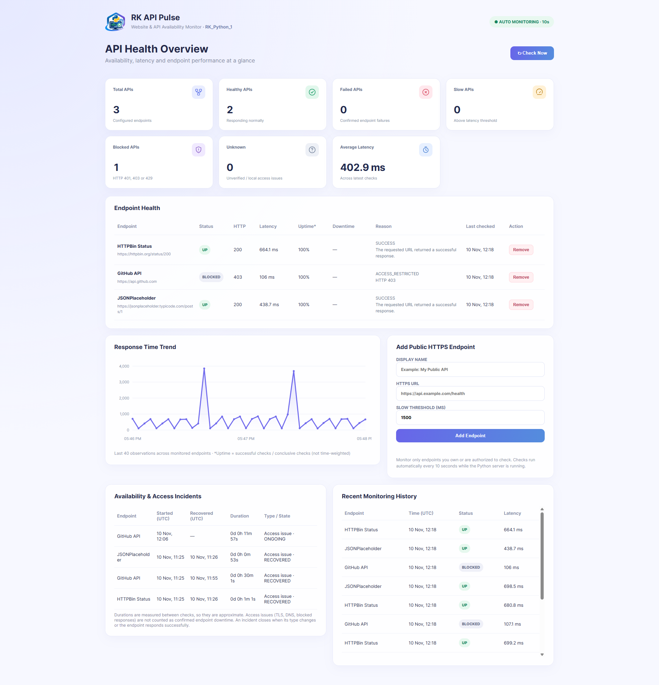
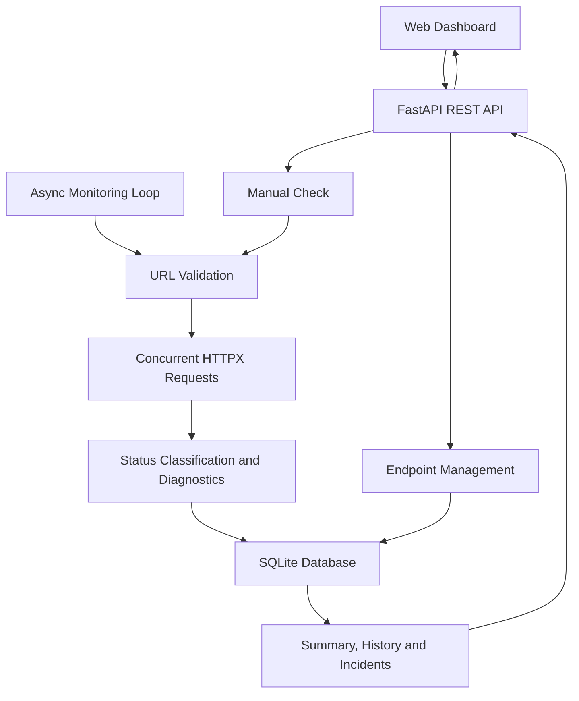

# 🌐 RK API Pulse | Website & API Availability Monitoring System


## 📌 Project Overview

RK API Pulse is a Python-based website and API availability monitoring application developed using FastAPI, HTTPX and SQLite. It monitors public HTTPS endpoints, measures response latency, classifies availability, records incidents and presents historical performance through a web-based dashboard.

Developed as a hands-on Python engineering and operational analytics project, it demonstrates asynchronous API integration, relational data management, automated monitoring and diagnostic analysis.

## 🎯 Project Objectives

- Automate website and API health checks.
- Identify availability failures, access restrictions and high response latency.
- Track incident start times, recovery times and estimated downtime.
- Maintain historical monitoring records and calculate availability indicators.
- Provide a lightweight dashboard for endpoint management and performance analysis.

## 🛠️ Technology Stack

| Technology              | Purpose                                         |
| ----------------------- | ----------------------------------------------- |
| Python                  | Core application development                    |
| FastAPI                 | REST API and application lifecycle              |
| HTTPX                   | Asynchronous HTTPS requests                     |
| asyncio                 | Concurrent monitoring and background scheduling |
| SQLite                  | Endpoint, check history and incident storage    |
| HTML5, CSS3, JavaScript | Dashboard and response-time visualization       |
| Pydantic                | Request data validation                         |
| Uvicorn                 | ASGI application server                         |
| Pytest                  | Automated regression testing                    |
| Swagger UI / OpenAPI    | Interactive API documentation                   |

## 📊 Monitoring Capabilities

| No. | Feature                  | Operational Purpose                                                |
| --: | ------------------------ | ------------------------------------------------------------------ |
|   1 | Automated health checks  | Run concurrent checks with a default 10-second wait between rounds |
|   2 | Manual monitoring        | Trigger a check using Check Now                                    |
|   3 | Status classification    | Distinguish UP, SLOW, DOWN, BLOCKED and UNKNOWN                    |
|   4 | Latency measurement      | Record response time in milliseconds                               |
|   5 | Error diagnostics        | Identify HTTP, TLS, DNS, timeout and connection problems           |
|   6 | Incident tracking        | Record ongoing and recovered incidents                             |
|   7 | Endpoint management      | Add, list and remove public HTTPS endpoints                        |
|   8 | Availability analytics   | Calculate per-endpoint uptime percentage                           |
|   9 | Historical visualization | Display recent checks and response-time trends                     |
|  10 | Data retention           | Periodically remove expired check records                          |

## 🖥️ Application Preview

<p align="center">
  
</p>
<p align="center"><i>Figure 1: RK API Pulse Monitoring Dashboard</i></p>

## ⚙️ Application Architecture



## 🔍 Status Classification

| Status      | Condition                                                                            |
| ----------- | ------------------------------------------------------------------------------------ |
| `UP`      | Successful response below the configured latency threshold                           |
| `SLOW`    | Successful response at or above the threshold                                        |
| `DOWN`    | HTTP 404, 410, 5xx or applicable request/connection failure                          |
| `BLOCKED` | HTTP 401, 403, 407 or 429                                                            |
| `UNKNOWN` | Redirects, other 4xx responses, URL validation failures or TLS verification problems |

Access issues are distinguished from downtime in incident tracking. The default latency threshold for new endpoints is 1,500 ms and can be configured when adding an endpoint.

## 🗄️ Database Overview

| Table         | Purpose                                                  |
| ------------- | -------------------------------------------------------- |
| `endpoints` | Monitored endpoint names, URLs and latency thresholds    |
| `checks`    | Timestamped status, HTTP code, latency and error records |
| `incidents` | Incident type, start time, recovery time and duration    |

**Availability calculation:**

`Uptime (%) = 100 × (UP + SLOW checks) / (UP + SLOW + DOWN checks)`

BLOCKED and UNKNOWN results are excluded from the denominator. When no conclusive checks exist, uptime is unavailable. The metric uses retained check records, not continuous time-based availability.

## 🔗 REST API Endpoints

| Method | Endpoint                         | Purpose                                    |
| ------ | -------------------------------- | ------------------------------------------ |
| GET    | `/`                            | Monitoring dashboard                       |
| GET    | `/api/summary`                 | Endpoint status and aggregate metrics      |
| GET    | `/api/history?limit=100`       | Recent monitoring records                  |
| GET    | `/api/incidents?limit=100`     | Ongoing and recovered incidents            |
| POST   | `/api/endpoints`               | Register a new endpoint                    |
| DELETE | `/api/endpoints/{endpoint_id}` | Remove endpoint and its monitoring history |
| POST   | `/api/check-now`               | Request an immediate monitoring round      |
| GET    | `/docs`                        | Interactive Swagger documentation          |

Example request body for adding an endpoint:

```json
{
  "name": "Example Website",
  "url": "https://example.com",
  "slow_ms": 1500
}
```

## 📁 Project Structure

```text
Website-API-Availability-Monitor/
├── app/
│   ├── __init__.py
│   ├── checker.py
│   ├── config.py
│   ├── database.py
│   ├── main.py
│   └── static/
│       ├── app.js
│       ├── favicon.png
│       ├── index.html
│       ├── rk-python-icon.webp
│       ├── rk-python-logo.webp
│       └── style.css
├── tests/
│   ├── conftest.py
│   └── test_app.py
├── .gitignore
├── requirements.txt
├── Screenshot.png
└── README.md
```

## 💻 Installation and Setup

### 1. Clone the repository

```bash
git clone https://github.com/masterfde/Python.git
cd Python/Website-API-Availability-Monitor
```

### 2. Create and activate a virtual environment (Windows PowerShell)

```powershell
python -m venv .venv
.\.venv\Scripts\Activate.ps1
```

### 3. Install dependencies

```powershell
python -m pip install -r requirements.txt
```

### 4. Run the application

```powershell
python -m uvicorn app.main:app --port 8002
```

### 5. Access the application

- Dashboard: [http://127.0.0.1:8002](http://127.0.0.1:8002)
- API documentation: [http://127.0.0.1:8002/docs](http://127.0.0.1:8002/docs)

The database is initialized automatically on startup. Use one Uvicorn worker to avoid duplicate monitoring loops.

## 🔧 Configuration

| Environment Variable       | Default      | Purpose                                            |
| -------------------------- | ------------ | -------------------------------------------------- |
| `PULSE_DB`               | `pulse.db` | SQLite database path                               |
| `PULSE_INTERVAL_SECONDS` | 10           | Wait between monitoring rounds; minimum 10 seconds |
| `PULSE_KEEP_DAYS`        | 14           | Check history retention in days                    |

The request timeout is set to 8 seconds in `app/config.py`. The initial database includes HTTPBin, GitHub API and JSONPlaceholder sample endpoints.

## 🧪 Automated Testing

```powershell
python -m pytest -q
```

The test suite covers API routes, URL validation, status classification, diagnostics, incident lifecycle, TLS access issues, summary metrics, endpoint deletion, retention and static file serving.

## 📈 Analytical Capabilities

- Endpoint-level availability and response latency analysis.
- Historical performance trend visualization.
- HTTP error and access restriction diagnostics.
- Incident duration and recovery analysis.
- Aggregate endpoint health and average response-time indicators.

## ⚠️ Operational Limitations

- Only public HTTPS endpoints on port 443 are supported; redirects are not followed.
- Results reflect the monitoring machine's network perspective, not global availability.
- Incident durations are estimates based on periodic observations.
- The application does not provide authentication or distributed monitoring; use locally or behind appropriate access controls.
- URL validation is a basic safeguard, not a complete production-grade SSRF defense.
- Removing an endpoint also deletes its checks and incidents.

## 🚀 Future Enhancements

- Endpoint editing and pause/resume controls.
- Configurable monitoring intervals per endpoint.
- Authentication and role-based access control.
- PostgreSQL-backed storage and extended analytics.
- Multi-location monitoring and SLA reporting.
- Containerized deployment and CI/CD automation.
- Exportable incident and performance reports.

## 🎓 Learning Outcomes

- Python programming and modular backend development.
- REST API design and asynchronous HTTP integration.
- SQLite data modelling and operational analytics.
- Monitoring, observability and incident lifecycle management.
- Dashboard development and automated regression testing.

## 👨‍💻 Author

**Raj Kumar Master Meitei**

Data Science | Business Analysis | AI Engineering

[](https://github.com/masterfde)

---

Developed as part of hands-on Python, API Engineering, Operational Analytics and Monitoring System development.
